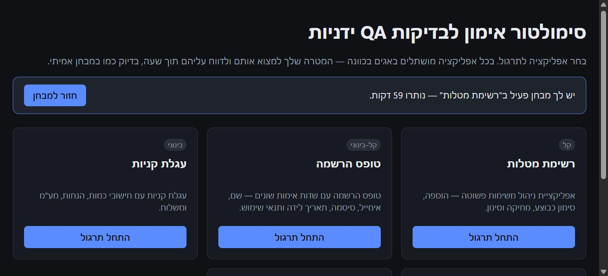
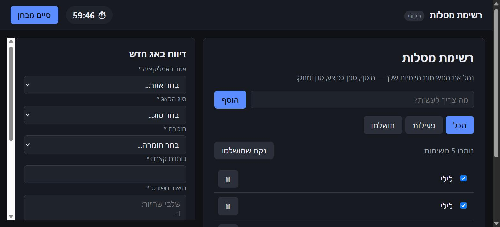
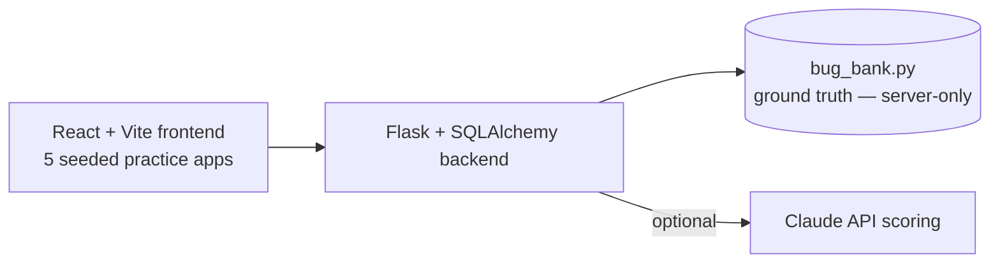

# סימולטור — BugRange

A local training simulator for manual QA bug-hunting, built to practice for take-home QA tests. Five small practice apps (a to-do list, a signup form, a shopping cart, a unit converter, a booking calendar) are seeded with intentionally planted bugs. A one-hour timer, a bug-report panel with edit/delete, and a full results breakdown at the end turn practice into something measurable.

> Source is kept private for now. This page shows real screenshots and the architecture.

## Screenshots

| Landing page | Live exam — timer + bug-report panel |
|---|---|
|  |  |

## Features

- Five independent practice apps, each with its own bug bank
- Bug-report sidebar: add, edit, delete reports while you work
- One-hour timer (configurable down to 1 minute for quick testing)
- Ground-truth bug bank lives server-side only — never sent to the client before the test ends, so it can't leak through devtools
- Optional AI-assisted scoring via the Claude API on top of a free heuristic scorer (works fully offline by default)

## Architecture

## Stack

React · Vite · Flask · SQLAlchemy · SQLite · optional Claude API
