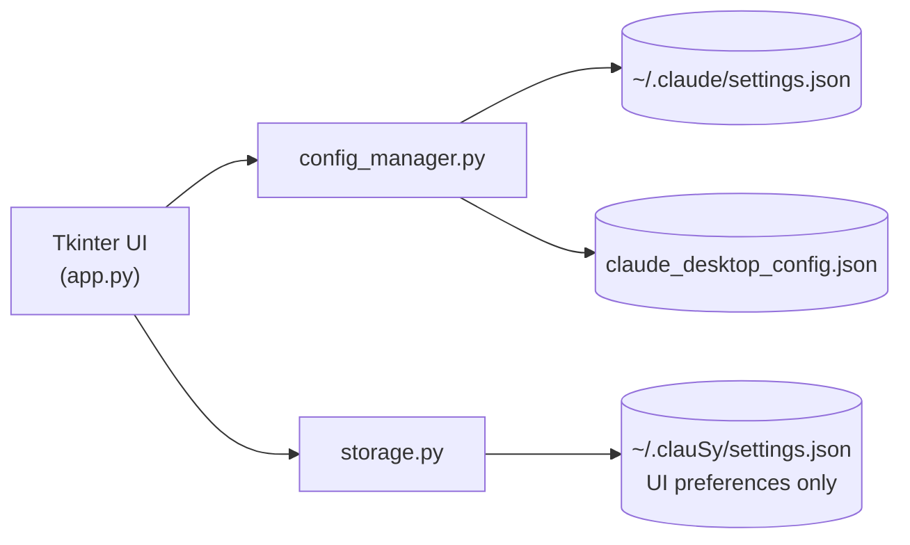

# ניהול הרשאות — ClAuSy

A dark-themed desktop app that manages which directories **Claude Code** and **Claude Desktop** are authorized to access — all from a single UI, without manually editing JSON config files.

**Code is public:** [github.com/MeirYaakovi/ClAuSy](https://github.com/MeirYaakovi/ClAuSy)

## Features

- Unified list — aggregates every authorized path from all Claude config sources
- Per-source toggles — independently enable/disable each path for Claude Code `permissions.allow`, `permissions.additionalDirectories`, and the Claude Desktop MCP filesystem server
- List & Thumbnail views, sortable by name or creation date
- Multi-select + column-header toggle to set several rows at once
- 30-level undo stack before committing changes
- Safe JSON patching — only touches the relevant key, never breaks surrounding content

## Architecture

## Stack

Python · Tkinter · no third-party dependencies
