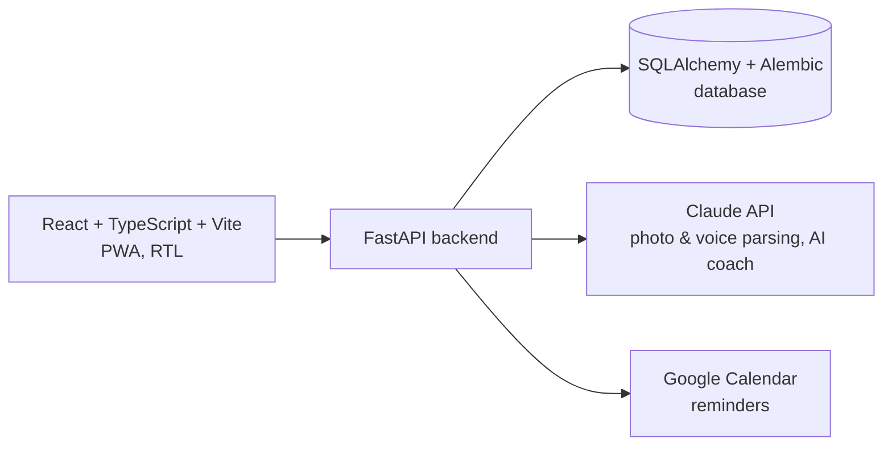

# בריאות — HealthTracker

A full-stack personal nutrition and fitness tracker — calories, macros, activity, and an AI coach. Meals can be logged manually, from a photo, or from a voice note; the backend uses the Claude API to parse all three into structured data.

> Source is kept private for now. This page shows the architecture and current status.

## Features

- Onboarding flow: login → consent → profile → goal → starting weight
- Dashboard with live counters and a macro ring
- Meal logging via manual entry, food photo, or voice transcription — all parsed through Claude
- Activity and workout logging, a progress graph with forecast
- AI Coach chat (a single wellness-coaching agent, explicitly not a medical one)
- Dark, sports-themed UI verified for CVD/contrast accessibility, full RTL support
- PWA — installable, with a basic service worker

## Architecture

## Status

- Backend: FastAPI + SQLAlchemy + Alembic, all endpoints in place (auth, consent, profile, goals, targets, meals, activity, workouts, dashboard, progress, coach, calendar)
- Calorie/macro calculation engine — BMR/TDEE formulas, covered by unit tests
- Claude integration tested end-to-end against the real API (food photo recognition, voice-note extraction, AI coach chat)
- Frontend fully wired and tested end-to-end in-browser (full onboarding flow + live AI coach)
- Google OAuth login + Calendar reminders — implemented, not yet exercised against real credentials

## Stack

React · TypeScript · Vite · FastAPI · SQLAlchemy · Alembic · Claude API · Google Calendar API
