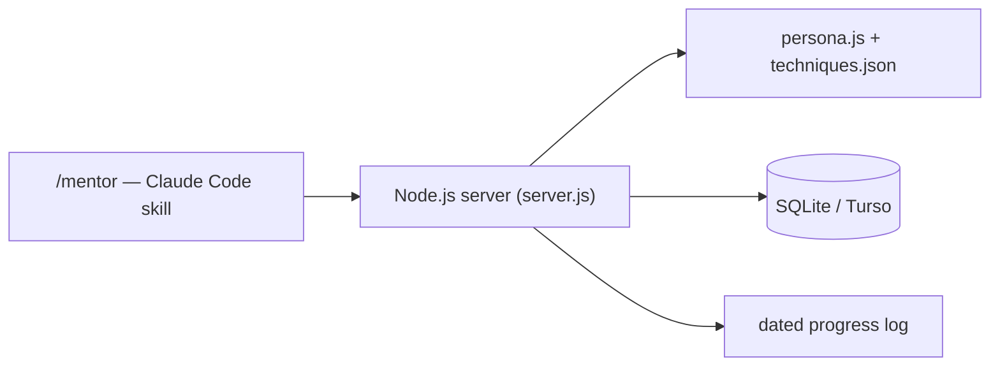

# מנטור — MyMentor

A daily AI interview-prep coach, run as a Claude Code skill (`/mentor`) so it's one command away instead of a separate app to open. It runs a focused practice session — STAR-method answers, technical QA questions, mental resilience — and logs a short progress note after every session so improvement is trackable over time instead of anecdotal.

> Source is kept private (the persona and progress log are personal). This page shows the architecture.

## Features

- Invoked as `/mentor` (optionally `/mentor <focus area>`) directly from Claude Code — no separate app to launch
- Persona and technique bank (`persona.js`, `techniques.json`) drive question selection and feedback style
- A backend service persists sessions and progress to a database instead of an in-memory chat
- Automatically appends a dated progress note at the end of each session

## Architecture

## Stack

Node.js · SQLite/Turso · Claude Code Skills
