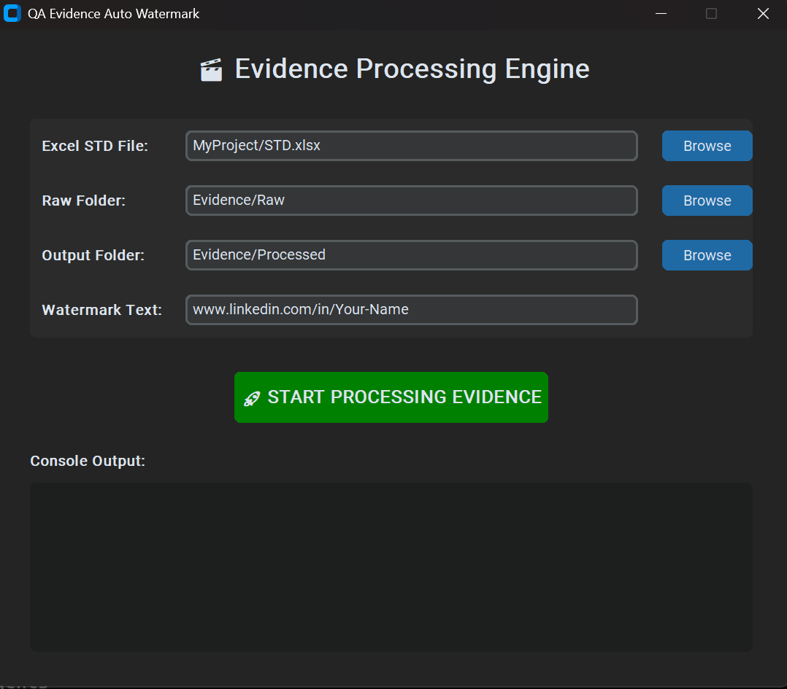
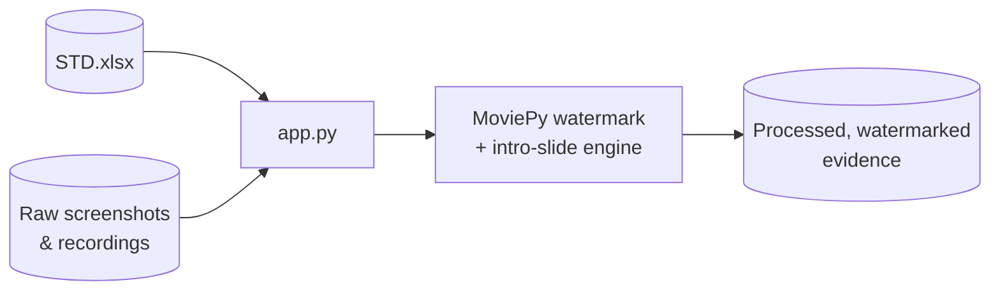

# טעימה — QA Evidence Auto-Watermark

Streamlines visual evidence prep for bug reports: it eliminates the manual, repetitive task of adding metadata to screenshots and screen recordings by parsing bug details straight from a QA results spreadsheet and embedding them into the media.

**Code is public:** [github.com/MeirYaakovi/QA-Evidence-Auto-Watermark](https://github.com/MeirYaakovi/QA-Evidence-Auto-Watermark)

## Screenshot

## Features

- Interactive desktop GUI built with CustomTkinter
- Multi-threaded rendering — media processing runs in the background, UI stays responsive
- Excel STD integration — auto-fetches bug summary, severity, category, and date by matching the file name to a bug ID
- Severity-based color coding on the watermark text (Show Stop / Critical / Major / Moderate / Low)
- Generates a 5-second video intro slide with full bug specs, plus a semi-transparent overlay watermark that adapts to vertical vs. horizontal media
- Built-in log console inside the GUI

## Architecture

## Stack

Python · CustomTkinter · MoviePy · Pandas · OpenPyXL
