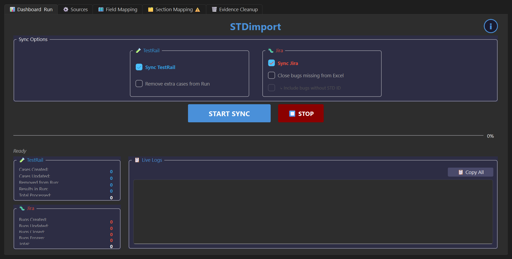
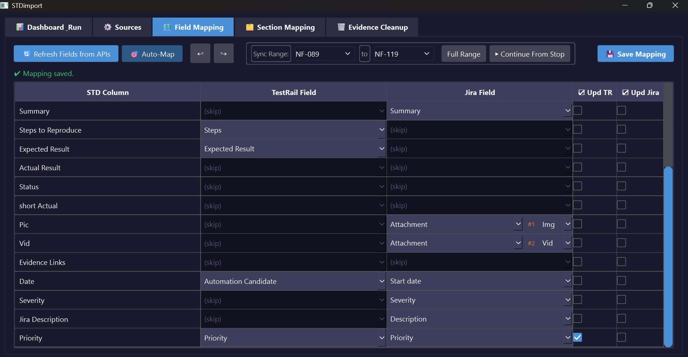
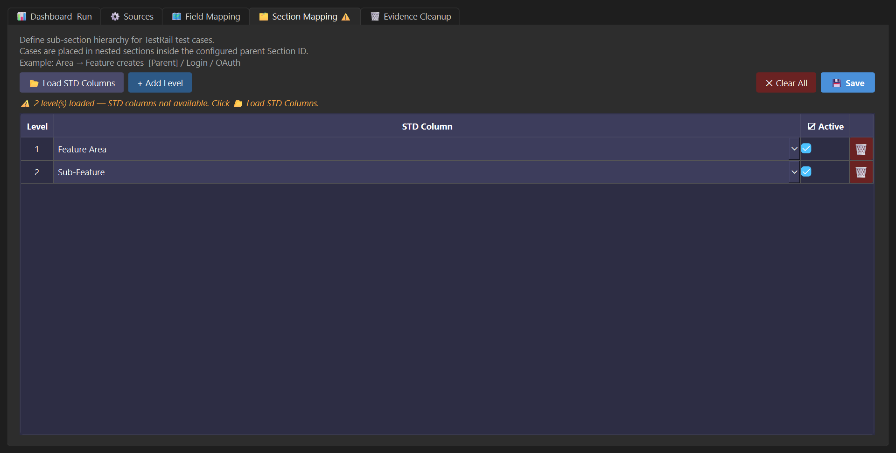
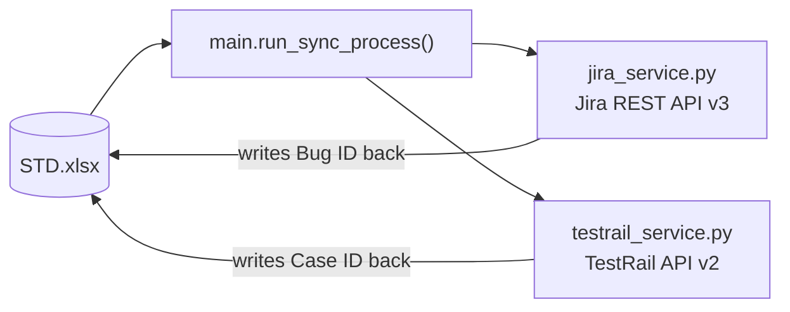

# סנכרון — STDimport

A PySide6 desktop app that reads a QA test-results spreadsheet (STD.xlsx) and syncs its rows to both **Jira** (bug tracking) and **TestRail** (test case management) — in both directions. Writes the Jira Bug ID and TestRail ID back into the spreadsheet after each sync, so the spreadsheet stays the single source of truth.

> Source is kept private (built against a client's real Jira/TestRail projects). This page shows real screenshots and the architecture.

## Screenshots

| Dashboard & Run | Field Mapping |
|---|---|
|  |  |

**Section Mapping** — configurable TestRail section hierarchy driven straight from spreadsheet columns:

## Features

- Sync failing rows → create/update Jira bugs; sync passing rows → auto-close them
- Upsert TestRail test cases and log results into a run
- Upload image/video evidence as Jira attachments, with ffmpeg compression fallback for large videos
- Field Mapping tab — map any spreadsheet column to any Jira or TestRail field, nothing hardcoded
- Section Mapping tab — define a multi-level TestRail section hierarchy from spreadsheet columns
- Evidence Cleanup tab — bulk-delete Jira attachments without running a full sync
- Sync Range with "Continue From Stop" — restrict a sync to an ID range and resume safely after a manual stop
- Pause/Resume mid-sync, and auto-pause/resume on network loss

## Architecture

| File | Role |
|---|---|
| `app.py` | PySide6 GUI — five tabs (Dashboard, Sources, Field Mapping, Section Mapping, Evidence Cleanup) |
| `main.py` | Row-by-row sync orchestration |
| `jira_service.py` | Jira REST API v3 wrapper — bugs, attachments, custom fields |
| `testrail_service.py` | TestRail API wrapper — cases, runs, section hierarchy |

## Stack

Python · PySide6 (Qt) · requests · openpyxl · pandas · Pillow · Jira REST API v3 · TestRail API v2
