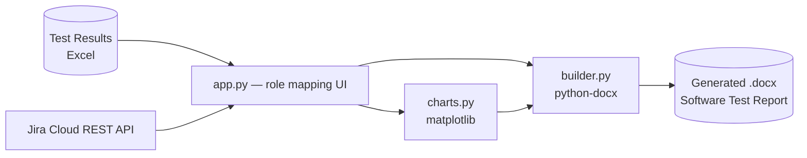

# מחולל דוחות — STR Builder

Desktop tool that compiles a complete **Software Test Report (.docx)** from a test-results spreadsheet and a live Jira defect pull — statistics, charts, color-coded tables, and per-defect pages generated in one click. What used to be a multi-hour manual write-up becomes a few minutes of review.

> Source is kept private (report layout was built around a specific client engagement). This page shows the architecture and feature set.

## Features

- **Any workbook** — map your own column names to report roles (ID, Status, Severity, Priority, Area, Category…) from the UI; nothing hardcoded
- **Charts** — execution-status donut, results-by-area, severity and priority breakdowns, rendered with matplotlib and embedded automatically
- **Color-coded tables** — Status/Severity/Priority cells shaded by value, repeating headers, no-split rows
- **Live Jira defects section** — pulls every defect matching a JQL query via the Jira Cloud REST API, including a field table, description, and first image attachment as evidence
- **Designed cover import** — embeds any .docx cover page 1:1, pinning the source theme's fonts and colors
- **Masking** — rows in chosen categories (e.g. Security) are redacted with `******` throughout the report
- TOC, page numbers, and header logo out of the box

## Architecture

## Usage

1. **Data tab** — pick the workbook, load columns, confirm the role mapping (auto-guessed by name)
2. **Jira tab** *(optional)* — credentials + JQL, validated with a test-connection check
3. **Build tab** — title, author, disclaimer, optional cover template and header logo → Generate Report

## Stack

Python · PySide6 · python-docx · openpyxl · matplotlib · requests · Pillow
